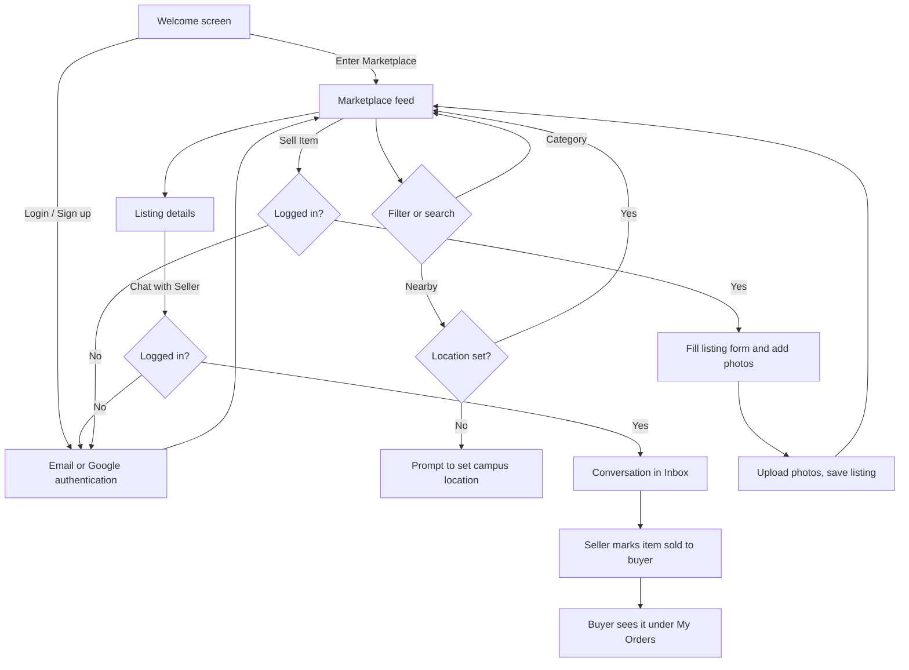
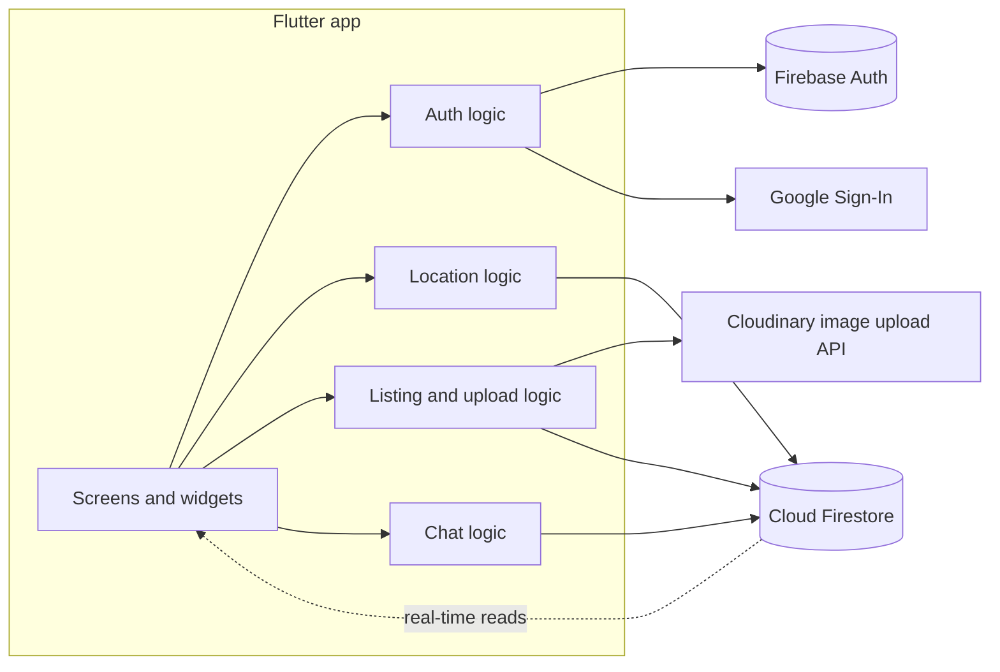
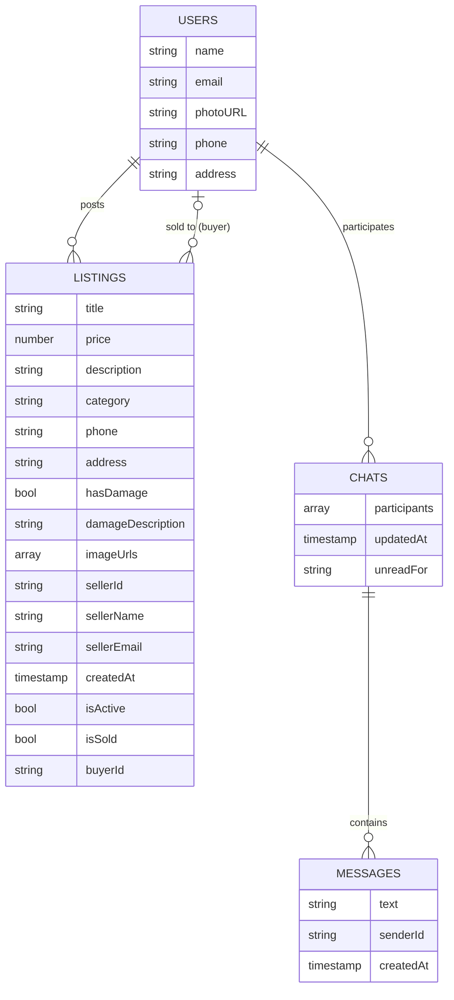

<div align="center">

# GritX

**A campus student marketplace built with Flutter and Firebase.**
Discover, list, chat about and sell items within your college community.


</div>

---

## Table of Contents

1. [Overview](#overview)
2. [The Problem and Our Approach](#the-problem-and-our-approach)
3. [Implemented Features](#implemented-features)
4. [Application Screenshots](#application-screenshots)
5. [User Journey](#user-journey)
6. [Technology Stack](#technology-stack)
7. [Architecture](#architecture)
8. [Data Model](#data-model)
9. [Repository Contents](#repository-contents)
10. [Prerequisites](#prerequisites)
11. [Installation and Setup](#installation-and-setup)
12. [Configuration](#configuration)
13. [Running and Building](#running-and-building)
14. [Feature Documentation](#feature-documentation)
15. [Challenges and Technical Learnings](#challenges-and-technical-learnings)
16. [Roadmap](#roadmap)
17. [Contributing](#contributing)
18. [License](#license)

---

## Overview

GritX is a mobile-first marketplace for students. A student signs in, sets a campus location, and can browse listings from other students by category, post their own items with photos, chat with sellers, and mark items as sold to a specific buyer. The app is written in Dart with Flutter, uses Firebase Authentication and Cloud Firestore for identity and data, and Cloudinary for image hosting.

The Dart package is named `student_marketplace` (see `pubspec.yaml`); the product name shown in the app and on the web page is **GritX**.

> **Note on repository contents.** At the time of writing, this repository contains the Flutter **web build output** (`main.dart.js`, `flutter_bootstrap.js`, `index.html`, ...) together with project configuration (`pubspec.yaml`, `pubspec.lock`, `analysis_options.yaml`, hosting config). The Dart source directory (`lib/`) and platform folders (`android/`, `ios/`) are **not committed**. Everything documented below was verified against `pubspec.yaml` and the user-facing strings, network endpoints and Firestore field names present in the compiled bundle. Anything that could not be verified is called out explicitly.

## The Problem and Our Approach

Students regularly need to sell or pass on textbooks, notes, electronics, sports gear and furniture, and to find the same things cheaply nearby. General classifieds are too broad, and group chats are unstructured and hard to search.

GritX narrows the scope to a student community:

- **Structured listings** with title, price, category, description and photos, instead of scattered chat posts.
- **Location-aware browsing**, where each user sets a campus or area and can filter to "Nearby".
- **Direct contact** through in-app chat with the seller.
- **A simple sale record**, where the seller marks an item as sold to a buyer who appears in "My Orders".

## Implemented Features

Verified from the compiled application bundle and `pubspec.yaml`.

| Area | What exists |
|---|---|
| Authentication | Email/password sign up and login, Google sign-in, "Forgot password?" reset-link email, "Skip for now" guest browsing |
| Gated actions | Posting, chatting and saving a location require login (the app shows "Login Required" prompts) |
| Browsing | "Active Listings" feed with a search field and category chips: All, Nearby, Books, Notes, Electronics, Sports, Furniture, Other |
| Location | Auto-detect via GPS, manual address entry, "Popular Regions" shortcuts, change location later; stored on the user profile |
| Selling | "Sell Item" flow: title, price (INR), description, category, phone number, address, multiple photos, and an optional product-damage declaration with details |
| Image hosting | Photos are uploaded to Cloudinary; the resulting URLs are stored on the listing |
| Listing management | "My Listings", delete listing with confirmation, protection against acting on your own listing |
| Chat | "Chat with Seller", "My Inbox", per-conversation messages, unread tracking |
| Orders | "Mark as Sold to Buyer", "Confirm Sale", sold badges, and a "My Orders" view of purchased items |
| Profiles | Public seller profile ("View profile & listings") and a personal profile with logout confirmation |
| UI | Animated interface using `flutter_animate`, hero transitions and cached network images |

### Not implemented / not verified

The following are **not** present in the codebase and should not be assumed:

- Online payments (the "Payment" text in the bundle is part of the Flutter engine, not a feature)
- Campus or student-ID verification (any account with an email or Google login can sign in)
- Push notifications
- Ratings or reviews
- An admin or moderation panel

## Application Screenshots

Real screenshots could not be generated when this README was written: the committed web build needs the Flutter engine and fonts from `gstatic.com`, and the repository does not ship the `assets/` folder, so a headless render would not represent the actual app. Rather than include mock-ups, this section is intentionally left for genuine captures.

To add them, run the app (see [Running and Building](#running-and-building)), capture the screens below, and place them in `docs/screenshots/`:

| Screen | Suggested file |
|---|---|
| Welcome / "Enter Marketplace" | `docs/screenshots/01-welcome.png` |
| Login and sign up | `docs/screenshots/02-auth.png` |
| Marketplace feed with category chips | `docs/screenshots/03-feed.png` |
| Location picker ("Where are you?") | `docs/screenshots/04-location.png` |
| Sell Item form | `docs/screenshots/05-sell.png` |
| Listing details | `docs/screenshots/06-listing.png` |
| Inbox and chat | `docs/screenshots/07-chat.png` |
| Profile, My Listings and My Orders | `docs/screenshots/08-profile.png` |

Once the files exist, a gallery can be added with relative paths, for example:

```markdown
<p align="center">
  
  
</p>
```

## User Journey



## Technology Stack

Dependencies are taken from `pubspec.yaml`.

| Layer | Technology | Purpose |
|---|---|---|
| Framework | Flutter, Dart `>=3.2.0 <4.0.0` | Cross-platform UI |
| Authentication | `firebase_auth`, `google_sign_in` | Email/password and Google sign-in |
| Database | `cloud_firestore`, `firebase_core` | Users, listings, chats and messages |
| Image upload | `image_picker`, `http` | Select photos and upload them to Cloudinary via its REST API |
| Location | `geolocator`, `geocoding` | GPS detection and address handling |
| Local storage | `shared_preferences` | Declared dependency |
| UI and motion | `flutter_animate`, `cached_network_image`, `dotted_border`, `cupertino_icons` | Animation, image caching, upload dropzone, icons |
| Linking | `url_launcher` | Declared dependency |
| State management | `provider` (declared) | See [State management](#state-management) |
| Animation | `rive` | Declared dependency; no `.riv` asset was found in the build |
| Tooling | `flutter_lints`, `flutter_test` | Linting and tests |
| Hosting config | `vercel.json`, `firebase.json` | SPA rewrite for Vercel; FlutterFire configuration record |

## Architecture



### State management

`provider` is declared as a dependency, but no `ChangeNotifier` or `ChangeNotifierProvider` usage was found in the compiled output. The app appears to rely on widget-local state (`setState`) combined with Firestore snapshot streams rendered through stream builders. This should be confirmed against the Dart source once it is committed.

### Navigation

Navigation uses Flutter's imperative `Navigator` with push/pop and hero transitions, and shows modal dialogs for confirmations (delete listing, confirm sale, logout).

### Backend communication

- **Firebase Auth** for sessions and identity.
- **Cloud Firestore** for all application data, using real-time snapshots for listings and chats.
- **Cloudinary** (unsigned upload preset over HTTPS `multipart/form-data`) for photos. Firebase Storage is **not** used.

### Error handling

User-facing messages exist for failed listing fetches ("Error fetching listings"), empty states ("No active listings", "No chats yet", "No orders yet"), login-required states, and success confirmations via snackbars (for example "Listing posted successfully!", "Location Updated!", "Item marked as sold!").

## Data Model

Collections observed in the bundle are `users`, `listings` and `chats` (with a `messages` collection per chat). Listing and chat field names were read directly from the compiled code; fields under `USERS` and `MESSAGES` are partly inferred, and all value types are inferred.



Firestore security rules are not part of this repository, so their contents are unknown.

## Repository Contents

```text
.
├── index.html                  # Web entry point (title: GritX)
├── main.dart.js                # Compiled Flutter web application
├── flutter.js                  # Flutter web loader
├── flutter_bootstrap.js        # Flutter web bootstrap
├── flutter_service_worker.js   # Service worker
├── manifest.json               # PWA manifest
├── version.json                # App name and version (1.0.0+1)
├── favicon.png                 # Site icon
├── pubspec.yaml                # Dependencies
├── pubspec.lock                # Locked dependency versions
├── analysis_options.yaml       # Lint configuration (flutter_lints)
├── firebase.json               # FlutterFire CLI configuration record
├── vercel.json                 # SPA rewrite: all routes -> /index.html
├── .metadata                   # Flutter project metadata
└── README.md
```

The Dart sources (`lib/`, including `lib/main.dart` and `lib/firebase_options.dart`, both referenced by `.metadata` and `firebase.json`) and the `android/`, `ios/` and other platform directories are not currently committed.

## Prerequisites

- [Flutter SDK](https://docs.flutter.dev/get-started/install) (stable channel) with Dart `>=3.2.0 <4.0.0`
- A Firebase project with **Authentication** (Email/Password and Google providers) and **Cloud Firestore** enabled
- A [Cloudinary](https://cloudinary.com/) account with an unsigned upload preset
- Android Studio / Xcode, or Chrome for web
- [FlutterFire CLI](https://firebase.google.com/docs/flutter/setup) (`dart pub global activate flutterfire_cli`)

## Installation and Setup

```bash
git clone https://github.com/rp1018/Gritx.git
cd Gritx
flutter pub get
```

`flutter pub get` resolves the dependencies from `pubspec.yaml`. Running the app from source additionally requires the `lib/` directory, which must be present in your checkout.

## Configuration

Credentials are never committed. Provide your own:

1. **Firebase.** Generate platform configuration with FlutterFire:
   ```bash
   flutterfire configure
   ```
   This creates `lib/firebase_options.dart`, and `android/app/google-services.json` for Android. Enable the Email/Password and Google sign-in providers in the Firebase console.
2. **Google Sign-In (web).** Set your OAuth client ID in the `google-signin-client_id` meta tag in `index.html`.
3. **Cloudinary.** The upload code reads a cloud name and an unsigned upload preset. Create a preset for your account and update the values in the source that performs the upload.
4. **Location.** Grant location permission when prompted. On Android and iOS, add the standard location permission entries required by `geolocator`.

## Running and Building

```bash
# Run on a connected device or emulator
flutter run

# Run in Chrome
flutter run -d chrome

# Build a web release
flutter build web --release

# Static analysis and tests
flutter analyze
flutter test
```

The existing web build is configured for static hosting with a single-page-app rewrite (`vercel.json`).

## Feature Documentation

### Authentication

Users can register with email and password, log in, request a password reset email, or continue with Google. Browsing is allowed without an account ("Skip for now"); posting, chatting and saving a location prompt the user to log in.

### Location

On first use a "Where are you?" screen offers GPS detection ("Use GPS"), a custom address, and "Popular Regions". The chosen address is saved to the user's profile and shown on the feed. The **Nearby** filter asks the user to set a location first if none is saved.

### Product listing workflow

1. The user taps **Sell Item** (login required).
2. They enter title, price, description, category, phone number and address.
3. They add one or more photos using the image picker, shown in a dotted-border upload area.
4. They optionally declare **Product Damage?** and describe the damage ("Transparency builds buyer trust fast").
5. Photos are uploaded to Cloudinary one by one ("Uploading to Galaxy...").
6. A document is written to the `listings` collection with the image URLs, seller details and `isActive: true`.
7. A confirmation snackbar appears and the user returns to the feed.

### Image handling

Photos are picked locally, sent as `multipart/form-data` to the Cloudinary upload endpoint using the `http` package, and only the returned URLs are stored in Firestore. Display uses `cached_network_image` to avoid re-downloading images.

### Chat

Opening **Chat with Seller** creates or merges a `chats` document keyed by the conversation, storing both participants and an `updatedAt` timestamp, and sets an `unreadFor` marker for the recipient. Messages are stored per chat and listed in **My Inbox**. Users cannot start a chat on their own listing.

### Marking items sold

A seller selects a chat counterpart as the buyer and chooses **Mark as Sold to Buyer**, followed by **Confirm Sale**. The listing is flagged as sold (with `buyerId`) and the buyer is notified in-app ("Item Sold to You!"). Purchased items appear under **My Orders**. No money moves through the app.

## Challenges and Technical Learnings

Based on the choices visible in the codebase:

- **Image hosting without a paid storage tier.** Photos are offloaded to Cloudinary using an unsigned preset, keeping Firestore documents small (URLs only).
- **Gating features for guests.** Browsing is open while writes require authentication, which required handling login-required states throughout the UI.
- **Location as a first-class concept.** Nearby filtering depends on a saved user location, so the UI has to handle the "not set" state gracefully.
- **Real-time data.** Listings and chats are driven by Firestore snapshot streams rather than manual refreshes.

## Roadmap

These are suggestions, not committed work.

- [ ] Commit the Dart source and platform folders so the project can be built from the repository
- [ ] Add real application screenshots under `docs/screenshots/`
- [ ] Verify users against a college email domain
- [ ] Add push notifications for new messages
- [ ] Add in-app payments or a documented offline payment flow
- [ ] Add seller ratings and reporting
- [ ] Document Firestore security rules
- [ ] Add automated tests

## Contributing

Contributions are welcome.

1. Fork the repository.
2. Create a branch: `git checkout -b feature/your-feature`.
3. Run `flutter analyze` and `flutter test` before committing.
4. Open a pull request describing the change.

Please do not commit API keys, `google-services.json`, or other credentials.

## License

No license file is currently included in this repository. Until one is added, all rights are reserved by the author. Add a `LICENSE` file (for example MIT) to define usage terms.

---

<div align="center">

Built by **Rithick (RP)** · [github.com/rp1018](https://github.com/rp1018)

</div>
